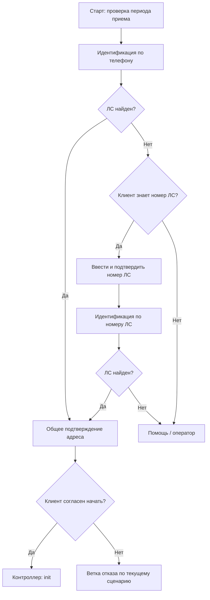

# Прием показаний: техническое описание для поддержки

Обновлено: 30.10.2026. Статус: настройка продуктивных сценариев продолжается. Документ описывает текущий код, согласованное поведение и показанную на скриншотах конфигурацию. Скриншот подтверждает наличие блоков и видимых связей, но не результат исполнения на проде.

Связанный документ: [описание для заказчика](implementation-customer.md).

## 1. Назначение и границы

Решение принимает показания всех приборов и всех их уникальных шкал выбранного ЛС. Одна шкала - одна запись в очередь и отдельный запрос передачи. Для многотарифного электросчетчика «День» и «Ночь» обрабатываются по отдельности. Приборы одной услуги не ограничиваются первым найденным.

Обрабатываются услуги в порядке настройки `services`: электроэнергия (`24`), горячая вода (`2`), холодная вода (`21`), отопление (`1`). Название услуги для реплик задается в родительном падеже. Дубли `MDScaleID` исключаются без учета регистра; используется первая запись в порядке услуг и ответа API. Специального объединения противоречащих данных дублей нет.

Озвучиваются последние три цифры номера. Код формирует `current_meter_number_short` как `item.number.slice(-3)`, то есть фактически берет три последних символа серийного номера, сохраняя нули. Полный номер остается в `current_meter_number`; текущим репликам он не нужен.

## 2. Состав реализации

| Компонент | Ответственность |
|---|---|
| `identification_phone.js` | Поиск ЛС по телефону, выбор адреса, выдача выбранного ЛС |
| `identification_account.js` | Поиск по цифровой части номера ЛС, тот же выбор адреса |
| `readings-soap-module.js` | XML, SOAP-запросы получения приборов и передачи одной шкалы |
| `readings-controller.js` | Очередь, состояние, проверки, пропуск, запись и маршруты статей |
| Сценарии платформы | Реплики, подтверждения, ввод, попытки исправления и помощь |

SOAP-модуль отмечается модулем на платформе и подключается к одному экземпляру контроллера. Код выполняется совместно, поэтому функции модуля используют его настройки и контекст. Имя JS-объекта `readingsSoap` не является ID агента. ID экземпляров задаются настройками и связями платформы; имена файлов не обязаны совпадать с ними.

Старый `submit-readings.js` в новой цепочке не используется. JS-код не устанавливает зависимости: нужны штатные `axios`, `https`, `xml2js`, `js2xmlparser`, `agentApi`, `agentStorage`, `logger` и `resolve`. Каждый загружаемый скрипт должен укладываться в лимит платформы 32 766 байт.

## 3. Что уже показано при настройке платформы

Пользователь сообщил о загрузке новых агентов, подключении SOAP-модуля и создании недостающих слотов. На скриншотах показаны следующие статьи.

| Статья | Видимая логика | Что еще проверяется |
|---|---|---|
| «Старт приема показаний» | Тема обращения; условие `day(TODAY()) <= 25`; очистка клиентского номера ЛС; установка маршрутов; вызов телефонной идентификации. После 25-го числа - информационное завершение | Фактические ID маршрутов и работа на входящем звонке |
| «Идентификация по номеру телефона результат» | Успех ведет в общую статью подтверждения адреса. При неуспехе спрашивается, известен ли номер ЛС: «Да» - ручная идентификация; отказ/ветка попыток - помощь | Переход по правильному symbolCode после ответа агента |
| «Идентификация по номеру ЛС старт» | Очистка `account_number_client`; анкета ввода; подтверждение номера; назначение следующей статьи; вызов идентификации по номеру | На фрагменте не видны все входящие связи; номер должен сохраняться от анкеты до вызова агента |
| «Идентификация по номеру ЛС результат» | Успех ведет в ту же общую статью подтверждения адреса; неуспех - помощь/оператор | Прохождение обеих ветвей |
| «Подтверждение адреса прием показаний» | Проверка ЛС и `address_success`; адрес; «Начнем?»; `readings_action = init`; добавлена команда `next_article` на «Запрос показаний»; контроллер | Контроллер не читает `next_article`: маршрут нужно задать в `articles.input`. Остались проверка отказов и сообщение в ветке незаполненного ЛС |

В телефонной статье результата на скриншоте стирается признак успеха после проверки. Это не мешает текущему продолжению: общая статья ориентируется на заполненность ЛС и `address_success`, а контроллер проверяет GUID. Повторная проверка `successful_identification = "true"` внутри общей статьи при такой настройке не должна добавляться без изменения этой очистки.

Пользователь обозначил статью «Запрос показаний» как следующий этап после контроллера. На новом скриншоте видна команда заполнения ее кода перед запуском агента, но не внутренние блоки этой статьи. После проверки кода пользователь согласовал убрать эту команду и указать статью в настройке контроллера; применение изменения еще не подтверждено. Содержимое общей статьи (`articles.input`), исправление, техническая ошибка и финал пока не подтверждены скриншотами. Ниже они описаны как согласованная схема настройки, а не как уже проверенная продуктивная конфигурация.

## 4. Сценарии идентификации и начала приема

### 4.1. Поиск ЛС

Телефонный агент берет значение из `phoneSlotId`, в шаблоне `sys_phone`. `useHardcodedPhone` на проде должен быть `false`. Запрос - `GetContractsInfo_By_Phone`. Агент по номеру берет цифровую часть из `numberSlotId`, в шаблоне `account_number_client`, проверяет цифровой формат и вызывает `FindAllByContractNumber`.

Оба агента больше не запрашивают приборы. После выбора они передают `account_id` из `ContractInfo.ID`, номер, адрес и признаки идентификации. Номер ЛС не заменяет GUID.

Единственный адрес выбирается автоматически. При нескольких адресах используются существующие нормализация слов/числительных, сопоставление адреса, подтверждение частичного совпадения и нумерованный список. При одинаковом адресе выбирается первый ЛС из ответа. Данные неполных или поврежденных результатов считаются технической ошибкой.

Состояние выбора хранится в собственном `dialogStorage` соответствующей идентификации под ключом `readings_identification`. Основные шаги: `ask_multiple`, `confirm_partial`, `choose_address`. Оно удаляется после выбора, пустого результата или перевода к помощи. Очистка слотов в сценарии не является сбросом этого состояния.

### 4.2. Маршрутизация результата

Идентификация возвращает статью через `/switchredirect`. Значение `classifier` имеет приоритет над `aiAgent`, `next_article` - над `nextArticle`. Телефонная идентификация должна возвращаться в свой результат, идентификация по номеру - в свой. Оба успешных результата ведут в общую статью подтверждения адреса.

**У контроллера другой контракт:** он не читает `next_article` и `classifier`. Возврат выполняется на `agentSettings.aiAgent`, а статьи берутся из `agentSettings.articles`. Для обычного ввода и успеха используется `articles.input`. Поэтому добавленная перед контроллером команда «Следующая статья = Запрос показаний» сама по себе маршрут не меняет. SymbolCode этой статьи нужно указать в `articles.input`; после этого команда не требуется. Переопределение маршрута через слот в код не добавлялось. Согласовано убрать команду из сценария и использовать `articles.input`; подтверждение выполнения ожидается.

Вызов идентификации должен передавать ей управление диалогом: агент может задавать дополнительные вопросы выбора адреса. После завершения он сам возвращает управление агенту сценариев.

Пустой корректный ответ поиска дает `successful_identification = "false"`. Поврежденный SOAP, сбой запроса или некорректные обязательные поля ведут в существующую статью оператора либо резервный маршрут.

### 4.3. Подтверждение адреса и начало

На показанной общей статье сначала проверяется заполненность номера ЛС. Если `address_success = "true"`, адрес уже подтвержден в идентификации и вопрос не повторяется. В остальных случаях озвучивается `account_address` и запрашивается подтверждение.

После подтверждения адреса задается вопрос:

> Я буду называть последние три цифры номера прибора учета и предыдущие показания. Пожалуйста, передавайте показания по названному прибору. Начнем? Скажите «да» или «нет».

Только положительный ответ заполняет `readings_action = "init"` и вызывает контроллер. По текущему скриншоту отрицательные ответы используют существующие ветки уточнения другого ЛС и помощи с темой обращения «Магеллан». Полную разводку этих ветвей нужно подтвердить отдельными крупными фрагментами или прохождением сценария; по одному общему изображению не фиксируются неразличимые связи.

На последнем скриншоте при незаполненном ЛС остается сообщение об отсутствии приборов. Это замечание к настройке: приборы еще не запрашивались. Для этой ветки согласовано нейтральное сообщение о невозможности определить ЛС и маршрут помощи. Само отсутствие приборов устанавливается после `init`.

Перед телефонной идентификацией можно очищать `account_number_client` и устаревшие маршрутные значения. `sys_phone` сохраняется. В общей статье отдельный сброс полей ЛС и показаний не требуется. Если анкеты используют один общий слот ответа «да/нет», его сбрасывают между вопросами средствами сценария.

## 5. Контракт данных

Все передаваемые значения слотов - строки. Регистрация слота в UI требуется, когда сценарий использует его в реплике, условии или команде заполнения. Поля, передаваемые только между агентами, отдельно в UI не создаются.

| Слот | Назначение | Использование в UI сценария |
|---|---|---|
| `account_id` | GUID выбранного ЛС | Техническая передача в контроллер, без отдельной регистрации |
| `account_number` | Номер ЛС | Уже использовался, проверка заполненности и реплики |
| `account_address` | Адрес | Уже использовался, подтверждение |
| `successful_identification` | Результат поиска | Уже использовался, ветки статей результата |
| `address_success` | Подтвержденное частичное совпадение | Уже использовался, пропуск повторного подтверждения адреса |
| `current_service` | Название услуги | Новый, реплика |
| `current_meter_number` | Полный номер прибора | Техническое поле, в текущих репликах не используется |
| `current_meter_number_short` | Последние три символа номера | Новый, озвучивание последних трех цифр |
| `current_meter_location` | Место установки | Необязательный, если добавлена соответствующая реплика |
| `current_scale_name` | Шкала или тариф | Новый, реплика |
| `current_previous_reading` | Предыдущее показание | Новый, реплика |
| `current_digits_after_dot` | Допустимая точность | Новый, сообщение об ошибке точности |
| `scale_type` | При точности 0 - `"true"`, иначе `"false"` | Новый, выбор способа запроса |
| `current_new_reading` | Ввод клиента | Новый, ввод и подтверждение; сохранять дробь |
| `reading_error` | Код ошибки 1-4 | Новый, выбор реплики исправления |
| `reading_status` | `ready`, `invalid`, `accepted` | Новый, выбор ветки после ответа контроллера |
| `skip_service` | Отказ от текущего прибора | Новый, команда сценария |
| `readings_action` | `init`, `process`, `next` | Новый, команда перед вызовом контроллера |
| `readings_step_id` | Идентификатор текущего шага | Технический контекст, без отдельной регистрации |
| `readings_sent_count` | Число переданных шкал | Новый, итоговая ветка |
| `readings_skipped_count` | Число пропущенных шкал | Новый, итоговая ветка |

Итого в прежнем согласованном списке - 13 новых UI-слотов, включая сокращенный номер; место установки добавляется по необходимости. `reading_retry` не используется.

В настройках идентификаций `slots` содержит только пять полей результата. `resetSlots` - объект с фактическими ID очищаемых слотов и значениями сброса. Обычно это пустая строка; старый `has_next_account` получает `"false"`. Не нужно заполнять пустые значения прежними показаниями. Старые несуществующие UI-слоты не создаются только ради очистки.

## 6. Контроллер: состояние, очередь, команды

Состояние записывается JSON-строкой в `dialogStorage.readings_controller`. Содержит `version`, выбранный `account`, `queue`, текущий `index`, `revision`, `cycleId`, список прежних `initIds` и порог `maxConsumption` для цикла. До обработки восстановленное состояние проверяется.

У записи очереди есть ID шкалы, `meterKey`, номер, место, услуга, название шкалы, прошлое и максимальное значения, точность, статус, новый ввод и ошибка. `meterKey` строится из позиции услуги и исходного прибора: одинаковые серийные номера разных `MDInfo` не объединяют приборы.

| Команда | Поведение |
|---|---|
| `init` | Проверить настройки и данные ЛС, запросить все услуги, построить очередь, сохранить ее, открыть первую шкалу либо финал |
| `process` | Проверить ЛС и ID шага; обработать пропуск или проверку подтвержденного значения и отправку |
| `next` | Разрешен после сохраненного успеха; перейти к следующей непропущенной шкале либо финалу |

На `init` обязательны GUID, номер ЛС, адрес и стандартный `message.id`. Повтор уже известного `message.id` не создает очередь заново. Новый поиск ЛС и новый init с новым ID начинают независимый цикл, заменяя текущую очередь; список ID ранее начатых циклов сохраняется в диалоге. Полного архива прежних очередей в этом ключе нет.

`readings_step_id` имеет вид `cycleId:index:revision`. Он обновляется при смене записи и при ошибке значения. Сценарий возвращает полученный ID без изменения. Старый ID приводит к показу актуального состояния без отправки/продвижения. Отсутствующий ID или несовпадающий ЛС - техническая ошибка.

Данные разных экземпляров агента не разделяют `dialogStorage`. Весь цикл необходимо вести одним экземпляром контроллера. Защита повторов рассчитана на последовательные вызовы: атомарного compare-and-set у используемых `get/set` нет.

## 7. Получение приборов и SOAP

`GetMDInfo_By_ContractIDAndNomenclatureCode` получает GUID ЛС и код услуги. Запросы четырех услуг выполняются параллельно, сбор очереди сохраняет порядок настройки. Одиночные `MDInfo` и `MDScaleInfo` приводятся к массивам, все шкалы проходят в обработку без фильтра единиц измерения.

Модуль строит SOAP 1.1, задает `Content-Type`, `SOAPAction`, `timeoutMs` и HTTPS-настройку `rejectUnauthorized`. XML-поля ищутся по локальному имени, независимо от префиксов пространств имен. Пустая корректная коллекция означает отсутствие приборов услуги. Неизвестная структура, поврежденные шкалы или отсутствие шкал у найденного прибора - техническая ошибка.

`InputOfReadingsWithDot` получает `MDScale_ID` из текущей записи очереди и нормализованное строковое `MDScale_NewReadings`. Пользовательский ввод не определяет ID шкалы. Успех - только явный `InputOfReadingsWithDotResult = 1`. Автоматических повторов HTTP внутри модуля нет.

## 8. Числовые проверки

Принимается неотрицательная десятичная строка с точкой или запятой; крайние пробелы удаляются. Запятая нормализуется в точку, ведущие нули целой части убираются. Экспонента, знак минус, неполный/посторонний текст и несколько разделителей отвергаются. Конечные нули дробной части учитываются при проверке точности и не отбрасываются для обхода ограничения.

Полные показания не переводятся в `Number`: сравнения и сложение выполняются над цифрами строк с выравниванием дробной части. Условие расхода проверяется как `new <= previous + maxConsumption`, без неточного вычитания float.

Все условия обязательны: `new >= previous`, `new <= previous + 100` при стандартном пороге и `new <= maximum`. Границы включительные. Значения API не обрезаются до точности нового ввода. Пустые обязательные значения и некорректная точность не заменяются нулем.

| Код | Проверка в порядке приоритета |
|---|---|
| `3` | Строка не является допустимым числом |
| `4` | Дробных знаков больше разрешенного |
| `1` | Значение меньше предыдущего |
| `2` | Превышен расход или максимум API |

При ошибке текущая шкала сохраняется, новый ввод остается доступен для реплики, `revision` увеличивается, открывается `articles.correction` с `reading_status = "invalid"`. SOAP-запись не выполняется.

## 9. Передача, пропуск и результаты

| Статус очереди | Значение |
|---|---|
| `pending` | Ожидание ввода; при наличии ошибки - ожидание исправления |
| `sending` | Значение сохранено перед HTTP-запросом |
| `sent` | API ответил 1, результат успешно сохранен |
| `skipped` | Оставшаяся шкала пропущенного прибора |
| `failed` | Явный отказ API или SOAP Fault |
| `unknown` | Передача не подтверждена: транспортный сбой, непонятный ответ и аналогичные случаи |

Порядок отправки: нормализовать значение, сохранить `sending`, выполнить запрос, сохранить `sent`, вернуть общую статью с `accepted`. Пока сценарий не произнес успех и не вызвал `next`, слоты относятся к отправленной шкале.

Если сохранить `sending` не удалось, HTTP не начинается. Если API принял значение, но сохранить успех не удалось, в хранилище остается `sending`, а сценарий получает техническую ошибку без `accepted`. Повторный вход при `sending`, `failed`, `unknown` снова ведет в техническую статью, не повторяя POST.

Пропуск по `skip_service = "true"` применяется раньше проверки ввода. Все оставшиеся `pending`-шкалы текущего `meterKey` помечаются `skipped`; ранее переданные остаются `sent`. Другие приборы той же услуги не пропускаются. После перехода временные поля и признак пропуска очищаются.

`reading_status` формирует агент: `ready` - новая шкала, `accepted` - сохраненный успех, `invalid` - ошибка значения. `readings_action` формирует сценарий. В техническом маршруте статус не объявляется успешным. При окончании очереди текущие слоты очищаются, остаются итоговые счетчики шкал.

## 10. Сценарии продолжения: согласовано, скриншоты ожидаются

| Этап | Требуемая логика |
|---|---|
| Общая статья, `ready` | Назвать услугу, последние три цифры номера, шкалу, прошлое показание; спросить готовность |
| Готовность: «Нет» | `skip_service = "true"`, `readings_action = "process"`, контроллер |
| Готовность: «Да» | По `scale_type` запросить целую часть или значение с поддержкой дроби |
| Подтверждение числа: «Нет» | Очистить ввод и запросить ту же шкалу без передачи |
| Подтверждение числа: «Да» | `process` с текущими ЛС, ID шага и значением |
| Общая статья, `accepted` | Озвучить успех этой шкалы, затем `next` |
| Исправление | Выбрать реплику по коду; одна повторная попытка внутри сценария; отказ или повторная подтвержденная ошибка - помощь |
| Техническая ошибка | Нейтральное сообщение, проверка результата и помощь; без автоматического повтора |
| Финал | Различить передачи/пропуски/пустую очередь, предложить другой ЛС; согласие ведет в ручную идентификацию |

Ответ «Нет» при подтверждении числа не является отказом от прибора. Попытки заполнения анкеты, видимые на скриншотах, и повтор после ошибки JS-проверки - разные механизмы. Счетчик исправлений не передается агенту и должен переживать переход из сценария в контроллер и обратно. При исправлении нельзя заново входить в блок новой шкалы и сбрасывать попытки.

## 11. Настройки и диагностика

Контроллер требует `url`, положительный целый `timeoutMs`, корректный порог, услуги, `aiAgent` и все четыре `articles`: `input`, `correction`, `error`, `finish`. `routingAgent` - резервный маршрут. ID слотов должны быть непустыми и уникальными. Статьи задаются их symbolCode; фактические значения прод-контура здесь не публикуются.

| Симптом | Что проверить |
|---|---|
| Возврат в старую статью или повторная идентификация | Приоритет `classifier` / `next_article`, настройки `aiAgent` / `nextArticle` и код статьи результата |
| Технический маршрут сразу на init | Все четыре статьи, URL, тайм-аут, доступность SOAP, GUID/номер/адрес, подключенный модуль |
| `Initialize readings first` | Тот ли экземпляр контроллера вызван; был ли init в этом диалоге |
| Нет продвижения после успеха | Сценарий должен после реплики передать `readings_action = next` |
| Старое значение попадает в повторный ввод | Очистка `current_new_reading` и собственных ответов анкеты, сохранение нового ID шага |
| Прибор пропускается вместо записи | Остаточный `skip_service = true` в сценарии |
| Дробь исчезает | Тип/извлечение значения в анкете, подтвержденная строка перед process, `scale_type` |
| Исправление повторяется бесконечно | Сохранение счетчика сценария через выход в агент, отсутствие сброса на повторном вводе |
| После сетевого сбоя нет успеха | Не считать это доказательством отказа: проверить состояние и учетную систему перед любым повтором |

Нет отдельной защиты от параллельной записи двух экземпляров одного шага: не включать параллельные вызовы. Уже принятые показания не отменяются возвратом входного маршрута на старую цепочку.

## 12. Проверки, выкладка и текущие задачи

Локальные проверки: `node --test ./readings.test.cjs`, проверки синтаксиса и размеров. HTTP и глобалы в тестах подменены; отдельный режим допускает обмен XML-строками через уже имеющийся адаптер. Это не проверка реального SOAP сервера или голосового канала.

На стенде/изолированном входе проверить обе идентификации, общий адрес, начальные нули номера, дробный ввод, повторные сообщения, несколько приборов/тарифов, пропуск, отказ, исправление и помощь. Стартовый календарный фильтр в показанном сценарии пропускает только 1-25 число; изолированная приемка не должна требовать изменения общего рабочего входа.

Выкладка отдельными экземплярами, переключение новых обращений, сохранение старых циклов и откат описаны в [плане развертывания](deploy-prod.md). При неопределенной передаче не очищать состояние и не запускать init ради повторного POST.

Текущие задачи по скриншотам:

1. Заменить сообщение об отсутствии приборов в ветке незаполненного ЛС на сообщение о проблеме определения ЛС.
2. Подтвердить на крупных фрагментах отрицательные ответы и ветви попыток в общей статье адреса.
3. Показать/проверить общую статью приема, исправление, техническую ошибку и финал.
4. Заполнить и сверить фактические маршруты всех статей; подтвердить прохождение, включая одну реальную согласованную передачу.
5. Убрать перед контроллером команду `next_article` и указать symbolCode «Запрос показаний» в `articles.input`: команда `next_article` из последнего скриншота не используется контроллером. Внутри этой статьи предусмотреть ветви `ready` и `accepted`.

## 13. Как поддерживать этот документ

После каждого нового скриншота обновлять соответствующую статью, условия, команды, реплики и статус подтверждения. Отделять показанное от предложенных исправлений; замечание не считать выполненным без нового подтверждения. При изменении правил обновлять и [документ заказчика](implementation-customer.md), сохраняя там деловое описание без внутренних ID и кода. Менять текущие описания, а не только дописывать журнал.

| Дата | Основание | Зафиксировано |
|---|---|---|
| 30.10.2026 | Код рабочей копии и скриншоты текущей переписки | Архитектура агентов; пять показанных статей; общий адрес после обоих способов поиска; init после «Начнем?»; озвучивание последних трех цифр |
| 30.10.2026 | Новый фрагмент общей статьи адреса | После `init` добавлено заполнение «Следующая статья» на «Запрос показаний». Зафиксировано отличие: контроллер использует `articles.input`, а не этот слот. Согласовано убрать команду и задать маршрут в настройках |

Дополнительные материалы: [контракт и подключение](readme.md), [подробный сценарий](scenario-plan.md), [блок-схемы](scenario-flowchart.md).

## 14. Общая блок-схема реализации

[Общая схема на одном листе](scenario-overview.md) объединяет старт, оба способа идентификации, адрес, весь цикл шкал, исправления и завершение. Доступны редактируемый draw.io, SVG для просмотра и PDF большого формата. Показанные блоки отмечены сплошной рамкой, еще не подтвержденное продолжение - пунктиром. Замечания и неразличимые ветви отражены отдельно; схема обновляется вместе с этим документом по новым скриншотам.
