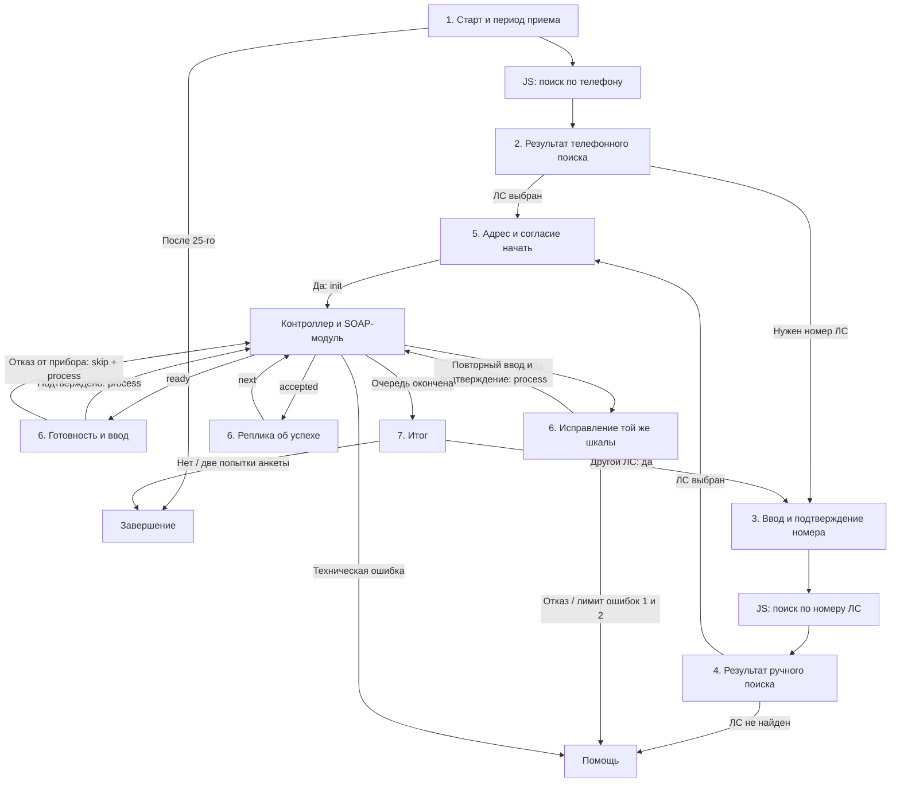

# Прием показаний: техническое описание

Актуализировано 02.11.2026 по четырем JS-файлам и трем файлам настроек. Здесь описаны устройство решения и правила сопровождения. 


## 1. Назначение и состав решения

Для одного выбранного лицевого счета (ЛС) последовательно обрабатываются все приборы и все их уникальные шкалы. Одна шкала — одна запись очереди и отдельная SOAP-передача. У многотарифного прибора тарифы обрабатываются отдельно. Автоматического перебора всех найденных ЛС нет: другой счет выбирается клиентом после завершения текущего.

| Компонент | Тип | Ответственность |
|---|---|---|
| `identification_phone.js` | Самостоятельный JS-агент | Поиск по телефону, выбор адреса, выдача одного ЛС |
| `identification_account.js` | Самостоятельный JS-агент | Поиск по цифровой части номера, тот же выбор адреса |
| `readings-controller.js` | Самостоятельный JS-агент | Очередь, валидация, пропуск, отправка и маршруты ответа |
| `readings-soap-module.js` | Подключаемый JS-модуль | Чтение приборов и запись одной шкалы |
| Агент сценариев `aiassist2` | Встроенный агент платформы | Исполнение статей, реплики, анкеты, подтверждения, метка исправления |
| `routingagent` | Встроенный маршрут | Помощь специалиста по действующим правилам |
| Завершение диалога | Действующий агент/переход платформы | В заметках вызов обозначен `finishdialog`; проверять фактическую связь в редакторе |

Итого три самостоятельных JS-агента и один модуль. ID экземпляров и symbolCode статей — разные сущности; имя файла не определяет ID. SOAP-модуль выполняется перед кодом контроллера в его контексте, пользуется его настройками и отдельно не вызывается. Все обращения `init/process/next` должны попадать в один экземпляр контроллера: его хранилище ограничено агентом и диалогом.

## 2. Семь основных сценариев платформы

Настроены **семь основных статей-сценариев**. Ввод, успех и исправление находятся в одной статье. Дополнительно используется существующая статья помощи/оператора для технических ошибок; она не входит в эти семь и не требует создания отдельного сценария приема.

| № | Статья / сценарий | Что выполняется | Основные выходы и участники |
|---|---|---|---|
| 1 | «Старт приема показаний» | Установка темы, проверка `day(TODAY()) <= 25`, очистка клиентского номера ЛС, подготовка маршрутов поиска | 1–25 число: телефонная идентификация; после 25-го: информационная реплика и завершение |
| 2 | «Идентификация по номеру телефона результат» | Проверка `successful_identification` | Успех: сценарий 5; неуспех: вопрос, известен ли номер ЛС. «Да»: сценарий 3; отказ/исчерпание попыток анкеты: помощь |
| 3 | «Идентификация по номеру ЛС старт» | Очистка `account_number_client`, запрос цифровой части номера, повтор номера для подтверждения, подготовка статьи результата | Подтвержденный номер: `identification_account.js`; неподтвержденный: повтор ввода. Дальнейший ответ агента: сценарий 4 |
| 4 | «Идентификация по номеру ЛС результат» | Проверка результата ручного поиска | Успех: сценарий 5; неуспех: помощь/оператор |
| 5 | «Подтверждение адреса прием показаний» | Проверка заполненности ЛС, при необходимости подтверждение `account_address`, объяснение порядка и вопрос «Начнем?» | `address_success="true"`: без повторного вопроса адреса. Согласие начать: `init` контроллера; отрицательные ответы: уточнение ЛС/помощь по действующим связям |
| 6 | Общая статья «Прием показаний по всем приборам…» | Разбор `ready/accepted/invalid`, готовность, целый/дробный ввод, подтверждение, пропуск, исправления | Контроллер с `process` или `next`; неизвестный статус/код: помощь |
| 7 | «Прием показаний итог» | Сообщение об окончании очереди и предложение другого ЛС | «Да»: сценарий 3; «Нет» либо две неудачные попытки итоговой анкеты: завершение |

Полное отображаемое название общей статьи в заметках обрезано; маршрут определяется ее symbolCode. Не считать отдельными сценариями ветки `accepted` и `invalid`: это входы той же статьи № 6. Четыре поля `articles` контроллера также не означают четыре разные статьи: `input` и `correction` совпадают.

Точная разводка отрицательных ответов и всех выходов анкет сценария 5 в заметках раскрыта не полностью. При сопровождении смотреть действующие связи редактора; новый порядок отказов из кода контроллера вывести нельзя. Для незаполненного ЛС в заметках остается замечание к реплике «нет приборов»: на этом этапе приборы еще не запрашивались, корректный смысл сообщения — не удалось определить ЛС. Это замечание к настройке, а не выполненное изменение платформы.

## 3. Цепочка диалога и маршрутизация



Успешные результаты обоих способов поиска сходятся в общем подтверждении адреса. Телефонная статья результата может очистить `successful_identification` после своей проверки; сценарий 5 ориентируется на заполненность ЛС и `address_success`, контроллер — на GUID/номер/адрес. Нельзя добавлять повторный обязательный тест `successful_identification="true"` после его очистки без согласованного изменения цепочки.

| Кто возвращает управление | Как выбирается маршрут |
|---|---|
| Идентификация: результат, включая пустой поиск | `/switchredirect` в `classifier || agentSettings.aiAgent`, статья `next_article || agentSettings.nextArticle` |
| Идентификация: ошибка/отказ выбора | При заданном `operatorArticle` — та статья в выбранном агенте сценариев; иначе `routingAgent` |
| Контроллер: новая шкала и сохраненный успех | `agentSettings.aiAgent` + `articles.input` |
| Контроллер: ошибка значения | Тот же агент + `articles.correction`; в текущих настройках это та же общая статья |
| Контроллер: техническая ошибка | `articles.error`; при некорректном маршруте — `routingAgent`, затем текстовая ошибка |
| Контроллер: конец очереди | `articles.finish`, без отдельного значения `finish` в `reading_status` |


## 4. Идентификация: входы, вопросы и ответы

Телефонный агент берет телефон из `phoneSlotId` (сейчас `sys_phone`) и вызывает `GetContractsInfo_By_Phone(PhoneNumber)`. Подстановка из `hardcodedPhone` действует только при `useHardcodedPhone=true`; в локальных настройках переключатель выключен. Агент по ЛС читает `numberSlotId` (сейчас `account_number_client`), требует только цифры и вызывает `FindAllByContractNumber(contractNumberDigits)`. В SOAP номер преобразуется в `Number`: ведущие нули цифровой части не сохраняются. GUID ЛС этим номером не заменяется.

Оба агента возвращают только выбранный ЛС, без получения приборов. Обязательны непустые `ContractInfo.ID`, `No`, строковый `Adress`. Город используется для сопоставления и озвучивания. Одинаковые нормализованные адреса объединяются с сохранением первого соответствующего ЛС.

| Состояние / результат | Ответ агента | Что происходит дальше |
|---|---|---|
| Корректный пустой поиск | Переход в статью результата с `successful_identification="false"`, поля ЛС пустые | Решение принимает статья результата |
| Один уникальный адрес | Переход в статью результата с выбранным ЛС | `address_success` остается пустым; адрес подтверждает сценарий 5 |
| Несколько адресов | «Назовите адрес, по которому Вы обращаетесь» | Агент сохраняет кандидатов и ждет ответ |
| Одно полное совпадение | Переход с выбранным ЛС | `address_success` пустой; общий сценарий подтверждает адрес |
| Одно лучшее частичное совпадение | «Вы обращаетесь по адресу: …? Скажите “да” или “нет”» | «Да»: выбор и `address_success="true"`; «Нет»: список |
| Непонятное подтверждение частичного адреса | Один повтор вопроса | Следующий непонятный ответ ведет к списку |
| Несколько полных совпадений, равный результат или нет подходящего | Нумерованный список адресов | Выбор номера либо отказ |
| Верный номер из списка | Переход с выбранным ЛС | `address_success` пустой |
| Неверный номер/непонятный ответ списка | Подсказка диапазона и один повтор | Следующая ошибка либо явное «нет»: помощь |
| Нет входного телефона, некорректный номер, поврежденный результат, SOAP/хранилище | Переход в помощь | Выходные поля и кандидаты очищаются |

Сопоставление нормализует регистр, «ё», пунктуацию, словесные числа и адресные компоненты. Полное совпадение учитывает город, улицу, дом и отсутствие конфликтующих уточнений квартиры/корпуса/строения. При неоднозначности агент не выбирает ЛС произвольно.

Выбор хранится JSON-строкой в собственном `dialogStorage.readings_identification` каждого агента: шаги `ask_multiple`, `confirm_partial`, `choose_address`. Пока есть сохраненное состояние, следующий вызов продолжает выбор, а не начинает новый поиск. После выбора/пустого поиска/помощи удаляются этот ключ и прежние `contracts`, `contracts_addresses`, `contracts_pagination`. Очистка выходных слотов сама по себе состояние выбора не удаляет.

Вызов должен передавать идентификации управление диалогом на время уточняющих вопросов. На `message_type=0` сохраненный вопрос повторяется, на обычном ответе продолжается выбор. Системные типы, включая 200, возвращают ACK. Идентификации также допускают отсутствие `message_type`; контроллер обрабатывает только явные 0 и 1.

## 5. Контракт слотов

В текущих настройках контроллера **21 поле**. Все значения слотов — строки, в том числе флаги, коды и счетчики. Пять общих полей должны иметь одинаковые фактические ID у обоих агентов идентификации и контроллера. При переименовании поля цикла обновлять также `resetSlots` обеих идентификаций и блоки сценария.

| Ключ `slots` | ID в текущих настройках | Кто формирует / назначение |
|---|---|---|
| `accountId` | `account_id` | Идентификация: `ContractInfo.ID`; контроллер сохраняет на цикл |
| `contract` | `account_number` | Идентификация: номер выбранного ЛС |
| `address` | `account_address` | Идентификация: адрес выбранного ЛС |
| `authSuccess` | `successful_identification` | Идентификация: `"true"/"false"`; контроллер формирует по наличию ID |
| `addressSuccess` | `address_success` | `"true"` только после явного подтверждения частичного совпадения внутри идентификации; иначе пусто |
| `service` | `current_service` | Контроллер: название услуги для реплики |
| `meterNumber` | `current_meter_number` | Полный серийный номер ПУ |
| `meterNumberShort` | `current_meter_number_short` | Последние три символа номера через `slice(-3)`; сохранять текстом и не терять нули |
| `meterLocation` | `current_meter_location` | Место установки; допускается пустое |
| `scaleName` | `current_scale_name` | Название шкалы; технический контекст, в текущий вопрос не добавляется |
| `previousReading` | `current_previous_reading` | Предыдущее показание текущей шкалы |
| `digitsAfterDot` | `current_digits_after_dot` | Допустимое число дробных знаков из API |
| `scaleType` | `scale_type` | `"true"` при точности 0, иначе `"false"`; выбор анкеты |
| `newReading` | `current_new_reading` | Сценарий: подтверждаемое значение; контроллер возвращает его, при отправке нормализует |
| `error` | `reading_error` | Контроллер: пусто либо `"1"/"2"/"3"/"4"` |
| `status` | `reading_status` | Контроллер: `"ready"/"invalid"/"accepted"`; на техническом маршруте и в финале пусто |
| `skip` | `skip_service` | Сценарий: ровно `"true"` для пропуска оставшихся шкал текущего ПУ |
| `action` | `readings_action` | Сценарий: `"init"/"process"/"next"` перед каждым вызовом |
| `stepId` | `readings_step_id` | Контроллер: непрозрачный ID шага; сценарий возвращает без изменения |
| `sentCount` | `readings_sent_count` | Число шкал со статусом `sent` |
| `skippedCount` | `readings_skipped_count` | Число шкал со статусом `skipped` |

Дополнительные входы и переменные сценария:

| Поле | Назначение и владелец |
|---|---|
| `sys_phone` | Телефон канала; вход телефонной идентификации |
| `account_number_client` | Введенная цифровая часть номера; вход идентификации по ЛС |
| `classifier`, `next_article` | Переопределения возврата идентификации; контроллер их не обслуживает |
| `readings` | Анкета целого ввода; затем копируется в `current_new_reading` |
| `point_readings` | Анкета ввода с дробью; затем копируется в `current_new_reading` |
| «Метка показания» | Собственная переменная сценария исправлений |
| `routing_text`, тема обращения | Контекст существующей помощи; задается сценарием |

Отдельного `reading_retry` в контракте нет. Контроллер не хранит, не возвращает и не копирует собственные переменные сценария, включая метку исправления.

### Правила очистки и сохранения

- Идентификация при каждом ответе объединяет `resetSlots` с очищенными пятью полями результата, затем заполняет выбранный ЛС. Это очищает слоты прежнего цикла, но не удаляет `readings_controller` другого агента.
- `resetSlots` содержит фактические ID и значения сброса: обычно `""`, для прежнего `has_next_account` — `"false"`. Старые группы `number_*`, `recent_*`, `scale_*`, `scale_id_*`, `readings_*` только очищаются; новую логику по ним не строить.
- Контроллер явно возвращает все 21 поле. `action` и `skip` в ответе пустые; на новой шкале также пусты ввод и ошибка. После успеха поля относятся к отправленной шкале вплоть до `next`.
- На `invalid` сохраняются шкала, ввод и код ошибки, но меняется ID шага. На техническом маршруте `reading_status` очищается. В финале очищаются поля текущей шкалы, ID, действие и пропуск, остаются выбранный ЛС и счетчики.
- Зарегистрировать текстовый `readings_step_id`, сохранять его от ответа контроллера через все анкеты до `process/next`. Не генерировать его в сценарии и не заменять пустое поле догадкой из состояния.
- Перед новым вводом в принятой настройке `point_readings`, `current_new_reading`, `skip_service` очищаются группой, а `readings` — отдельной точечной командой «Показания до запятой». Шаблон по подстроке `readings` может также стереть `readings_step_id`, действие и счетчики. Если используется регулярное выражение, ограничивать полные ID.
- «Метка показания» стирается только при входе `ready` на новую шкалу. На `invalid` она сохраняется. Не сбрасывать поля ЛС и ID шага в общей очистке пользовательского ввода.

## 6. Общая статья приема и возможные ответы контроллера

| Вход / событие | Действие сценария | Действие контроллера |
|---|---|---|
| `ready` | Стереть метку новой шкалы, назвать услугу, короткий номер, прошлое показание; спросить готовность | Ждет следующего вызова |
| Готовность «Да» | Очистить временный ввод и пропуск; выбрать анкету по `scale_type` | Не вызывается до подтверждения числа |
| Готовность «Нет» | `skip_service="true"`, `readings_action="process"`, вернуть текущий ID | Пропустить оставшиеся шкалы этого ПУ, открыть следующую либо итог |
| Ввод | При `scale_type="true"`: целая часть из `readings`; иначе ввод с возможной дробью из `point_readings` | Получит только общее значение `current_new_reading` |
| Число не подтверждено | Повторить ввод той же шкалы | Отправки и пропуска нет |
| Число подтверждено | Пропуск пустой, `process`, актуальные ЛС и ID | Проверка; `invalid`, `accepted` либо техническая ошибка |
| `invalid` | Разобрать `reading_error`, сохранить метку и новый ID; предложить исправление | При повторе проверяет ту же шкалу |
| `accepted` | Сообщить об успехе текущего показания, затем вызвать `next` с его ID | Только теперь сменить шкалу или открыть итог |
| Неизвестный/пустой статус внутри общей статьи | Нейтральная реплика и помощь | Сценарий не присваивает успех самостоятельно |

Принятая реплика готовности содержит `current_service`, `current_meter_number_short`, `current_previous_reading`; `current_scale_name` по решению заказчика в вопрос не включается. Даже без озвучивания шкалы каждый тариф остается отдельным шагом. Для дробного голосового ввода текущая подсказка использует слово «точка»; SOAP получает числовую строку. Целое число допустимо и при разрешенной дробной точности.

Ответ контроллера — массив `ReplyMessage` с текстовой командой `/switchredirect` и заполненными слотами. При отсутствии корректного технического маршрута и резервного агента возможен текст «Не удалось продолжить прием показаний. Обратитесь к оператору.». Для системных типов возвращается ACK; самый последний защитный `catch` также возвращает ACK при сбое формирования ответа.

### Ошибки значения и повторы

| Код | Причина / смысл реплики | Продолжение в сценарии |
|---|---|---|
| `"1"` | Значение меньше предыдущего; назвать прошлое и предложить изменить | Если метка пустая — одно исправление; если заполнена — помощь |
| `"2"` | Превышен допустимый прирост или максимум API | То же правило одной попытки через метку |
| `"3"` | Не получено корректное неотрицательное число | Предложить повтор ввода без счетчика |
| `"4"` | Дробных знаков больше допустимого | Повтор ввода без счетчика, как для кода 3 |
| Неизвестный код | Нельзя определить корректную реплику исправления | Помощь, без отправки |

Для 1/2 при согласии исправить сценарий заполняет «Метку показания», очищает ввод, снова получает и подтверждает число. При отказе — помощь с контекстом `routing_text` и темой передачи показаний. Повторная ошибка 1/2 при заполненной метке не дает еще одну такую попытку. Для 3/4 по принятому решению нет собственного счетчика. Нельзя вводить прежнее правило «одна попытка для всех кодов».

Полное влияние переходов 3/4 на метку при смешанных последовательностях ошибок в заметках не раскрыто. При изменении сценария сохранять принятое различие правил; не добавлять скрытый общий лимит и не сбрасывать уже использованную метку 1/2 через вход новой шкалы. Неизвестные ответы анкеты не равны коду JS-валидации: это отдельные выходы анкет платформы.

## 7. Очередь, состояние и защита повторов

Состояние контроллера — JSON-строка `dialogStorage.readings_controller`:

- `version=1`, выбранный `account` (ID, номер, адрес, признак подтверждения);
- `queue`, текущий `index`, `revision`;
- `cycleId` из `message.id`, список ранее начатых `initIds`;
- `maxConsumption` для остальных услуг, зафиксированный при начале цикла; также используется старыми очередями без лимитов отдельных шкал.

В каждой новой записи `queue` сохраняется собственный `maxConsumption`: из `agentSettings.maxConsumptionElectricity` для услуги с `isElectricity: true`, из `agentSettings.maxConsumption` для остальных. Изменения настроек в середине цикла не меняют сохраненные лимиты. Оба параметра обязательны; при обновлении перенести код и настройки вместе. Уже начатые старой версией циклы продолжаются с прежним общим порогом.

Запись очереди содержит `id` шкалы, `meterKey`, серийный номер, место установки, услугу, название шкалы, прошлое/максимальное показания, точность, статус, значение и ошибку. `meterKey=serviceIndex:meterIndex`: разные исходные приборы с одинаковыми номерами не объединяются.

| Команда | Обязательный вход | Результаты |
|---|---|---|
| `init` | `message.id`, `account_id`, `account_number`, `account_address` | Получить все услуги, собрать и сохранить очередь; `ready` либо финал; сбой — техническая статья |
| `process` | ЛС текущего цикла, непустой текущий ID; значение либо пропуск | Валидация/передача или пропуск; `invalid/accepted/ready`, финал либо техническая статья |
| `next` | ЛС и ID уже отправленной шкалы | Продвижение после успеха; до успеха — техническая ошибка |

ID имеет вид `cycleId:index:revision`, но для сценария остается непрозрачной строкой. Он обновляется при продвижении и ошибке значения.

| Повтор / нарушение | Поведение |
|---|---|
| `init` с уже известным `message.id` | Показ текущего сохраненного состояния, без новой загрузки очереди |
| `init` с новым ID | Новый цикл, заменяющий текущую очередь; старые ID запуска сохраняются, старые очереди целиком не архивируются |
| Старый непустой ID шага | Возврат актуального состояния без отправки и продвижения |
| Повторный `process` уже переданной шкалы | Возврат `accepted` без POST |
| Нет ID, другой ЛС, неизвестное действие, нет начатого цикла | Техническая ошибка |
| Текущая шкала `sending/failed/unknown` | Технический маршрут без повторного POST |

Проверяется наличие ID ЛС, но его формат GUID отдельной регуляркой не валидируется. Аналогично ID шкалы обязан быть непустым, а не проходить отдельную проверку GUID. Обязательные данные и структура сохраненного состояния проверяются перед продолжением; поврежденные данные не восстанавливаются подстановкой нулей.

Защита действует для последовательных вызовов в пределах этого состояния и диалога. `dialogStorage.get/set` не дает атомарного compare-and-set: параллельные вызовы одного шага не защищены от двойной отправки. Нет глобальной дедупликации между диалогами или новыми циклами. Поэтому после неопределенной передачи нельзя запускать новый `init` как способ повтора.

## 8. SOAP, построение очереди и валидация

Услуги в текущем порядке `services`: 24 — «электроэнергии», 2 — «горячей воды», 21 — «холодной воды», 1 — «отопления». Запросы услуг выполняются параллельно, очередь собирается в порядке настроек, затем приборов и шкал API.

| Метод SOAP | Параметры | Назначение |
|---|---|---|
| `GetContractsInfo_By_Phone` | `PhoneNumber` | Поиск кандидатов ЛС телефонной идентификацией |
| `FindAllByContractNumber` | `contractNumberDigits` | Поиск кандидатов по номеру |
| `GetMDInfo_By_ContractIDAndNomenclatureCode` | `ContractStrGUID`, `NomenclatureCode` | Все приборы услуги выбранного ЛС |
| `InputOfReadingsWithDot` | `MDScale_ID`, `MDScale_NewReadings` | Запись одной шкалы из сохраненной очереди |

Модуль строит SOAP 1.1, POST, `Content-Type: text/xml; charset=utf-8`, `SOAPAction`, тайм-аут и HTTPS-агент. XML генерируется штатным сериализатором. Модуль ищет поля по локальным именам независимо от префиксов; у идентификаций сохранен разбор конкретной структуры `soap:Envelope/soap:Body`, поэтому изменение XML-префиксов может по-разному затронуть эти компоненты.

Одиночные `MDInfo` и `MDScaleInfo` модуль приводит к массивам. Берутся все шкалы без фильтра единиц и без выбора первой. Пустая корректная коллекция услуги допустима. Неизвестная структура, отсутствие шкал у найденного прибора, пустые номер/ID/название шкалы, поврежденные границы или точность — техническая ошибка всего формирования очереди. Частичная очередь при сбое одной услуги не используется.

Повторный `MDScaleID` исключается без учета регистра: сохраняются данные первой записи в порядке очереди. Разрешения конфликтов данных дублей нет.

Источник полей шкалы: `MDScaleID`, `MDScaleName`, `LastReadings`, `MDSDigitsAfterDot`, `MaxAcceptableNewMDReadingValue`. Именно `MDSDigitsAfterDot` определяет `scale_type`; целый вид прошлого значения не означает целую точность. Срок поверки, дата прошлых показаний и `ReadingsExist` в контроллере не используются как дополнительные фильтры допуска.

Ввод — неотрицательное десятичное число: цифры и необязательная дробь через точку или запятую. Крайние пробелы удаляются, запятая становится точкой, ведущие нули целой части убираются. Минус/плюс, экспонента, внутренние пробелы, текст, несколько разделителей, число без целой части или без цифр после разделителя отклоняются. Конечные нули дроби учитываются при проверке точности.

Порядок проверки: формат (код 3), точность (4), нижняя граница (1), верхние границы (2). Необходимо одновременно:

```text
new >= previous
new <= previous + (лимит шкалы; для старой очереди — общий maxConsumption цикла)
new <= MaxAcceptableNewMDReadingValue
```

Границы включительные. Сравнения и сложение выполняются над десятичными строками без преобразования всего показания в `Number` и без `BigInt`. Прошлая дробная часть не обрезается до точности нового ввода. Некорректная точность/границы API не заменяются нулем.

## 9. Передача, пропуск и завершение

| Статус записи очереди | Смысл |
|---|---|
| `pending` | Ожидает ввод; при заполненном коде ошибки — исправление |
| `sending` | Значение сохранено перед HTTP; завершение операции еще не зафиксировано |
| `sent` | API подтвердил запись и успех сохранен |
| `skipped` | Шкала пропущена вместе с оставшимися шкалами своего прибора |
| `failed` | Явный отказ API либо распознанный SOAP Fault |
| `unknown` | Неопределенный результат, например транспортный сбой или непонятный ответ |

Отправка: проверить и нормализовать → сохранить `sending` → POST → получить строковый `InputOfReadingsWithDotResult=1` → сохранить `sent` → вернуть `accepted`. HTTP 200 сам по себе не означает успех.

Если запись `sending` не удалась, HTTP не начинается. Если API принял значение, но сохранить `sent` не удалось, в хранилище остается `sending`; ответ уходит в техническую статью без успеха. Распознанный числовой отказ/ SOAP Fault дает `failed`; транспортный сбой, неразобранный XML/результат — `unknown`. Автоматических повторов HTTP нет. После сбоя результат проверяют в учетной системе до решения о повторе.

Пропуск проверяется до валидации ввода: `skip_service="true"` помечает `skipped` все еще ожидающие шкалы текущего `meterKey`. Уже переданные остаются `sent`, другие приборы услуги не затрагиваются. Затем происходит продвижение без реплики об успешной записи.

После `accepted` сценарий сначала произносит успех, затем вызывает `next`. В конце очереди контроллер открывает итог напрямую, очищает текущую шкалу и оставляет счетчики. Нейтральный итоговый вопрос из сценария № 7 допустим и при пустом перечне, и после пропусков. Если добавляется сводка, учитывать:

| Передано / пропущено | Допустимый смысл сводки |
|---|---|
| >0 / 0 | Показания переданы |
| >0 / >0 | Часть шкал передана, часть пропущена |
| 0 / >0 | Передачи не было, приборы пропущены |
| 0 / 0 | Доступных шкал не найдено |

Счетчики относятся к шкалам. Ответ «Да» в финале ведет к ручному поиску другого ЛС, подтверждению адреса и согласию начать. Он не вызывает `init` напрямую. «Нет» и две неудачные попытки заполнения финальной анкеты ведут к завершению; эти попытки не связаны с меткой исправления показаний.
