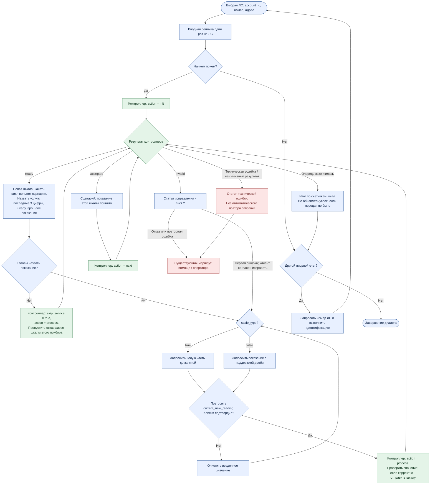
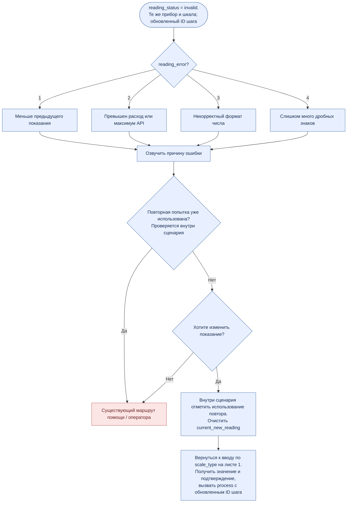

# Блок-схема приема показаний

| Task | Entrypoint | Customer |
|---|---|---|
| Блок-схема общего приема и исправления | Идентификация ЛС; статьи `input`, `correction`, `error`, `finish` | СИГУРД |

Редактируемая версия: [scenario-flowchart.drawio](scenario-flowchart.drawio), два листа. Реплики и настройка платформы: [scenario-plan.md](scenario-plan.md). Синие блоки - сценарий, зеленые - JS-контроллер, красные - техническая ошибка или помощь.

## 1. Основной цикл

Схема начинается после успешной идентификации и предусмотренного подтверждения адреса. Неуспешная идентификация остается в существующей цепочке.

Все вызовы `process` и `next` передают `account_id` и текущий `readings_step_id`. После ответа контроллера используется полученный ID. На следующую шкалу слоты переключаются только при `next`, после реплики об успехе. Пропуск касается прибора, успешная передача - одной шкалы.

## 2. Исправление значения

Счетчик попыток существует только в сценарии и должен сохраняться через переходы между агентами. Контроллер его не получает. Исправление возвращает к вводу той же шкалы, без повторного входа в блок новой шкалы и без сброса попыток. Ответ «нет» при подтверждении числа также возвращает к вводу; он не является пропуском или проверенной агентом ошибкой.
