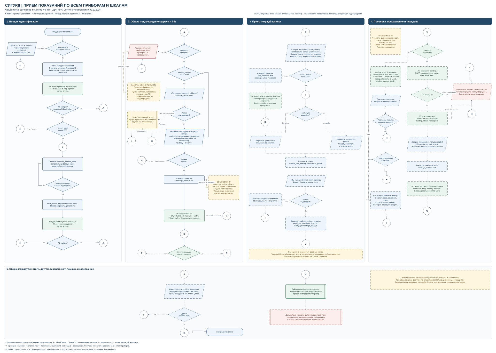

# Общая блок-схема приема показаний

Обновлено: 30.10.2026. Схема объединяет логику статей и вызовы агентов на одном листе по образцу исходной схемы голосового помощника.

## Файлы

- [Редактируемая схема draw.io](scenario-overview.drawio).
- [Векторная схема SVG](scenario-overview.svg).
- [PDF для передачи и просмотра с увеличением](output/pdf/scenario-overview.pdf).

PDF содержит одну страницу большого формата. Он не разбит на листы A4; мелкие ветви читать с увеличением. SVG подходит для просмотра схемы в Obsidian без установки редактора draw.io.

## Что показано

1. Календарная проверка приема, идентификация по телефону и по номеру ЛС.
2. Общая статья подтверждения адреса и вопрос «Начнем?» перед `init`.
3. Запрос каждой шкалы, выбор формата, подтверждение и пропуск прибора.
4. Проверка, отдельная отправка шкалы, исправление, сообщение об успехе и `next`.
5. Итоги по ЛС, другой лицевой счет, помощь и завершение.

Синий цвет - действия сценария; зеленый - агенты и интеграция; красный - помощь и ошибки. Сплошная рамка означает показанные на скриншотах блоки, пунктир - согласованное продолжение или связи, ожидающие подтверждения. Это статус настройки сценария, а не результат проверки исполнения на проде. Оранжевые примечания содержат замечания к показанной конфигурации.

Сообщение «Нет приборов» до запроса перечня оставлено как наблюдаемая ветка с замечанием. Предложенное исправление не отмечено выполненным. Не полностью различимые отрицательные ветви общей статьи адреса помечены как требующие сверки.

На последнем скриншоте перед контроллером добавлено заполнение `next_article` на статью «Запрос показаний». Контроллер этот слот не читает. Согласовано убрать команду и указать статью в `articles.input`. На схеме показан согласованный прямой вызов контроллера, а ожидающее применения изменение отмечено оранжевым примечанием. Внутренняя логика самой статьи пока не показана.

## Соединители

Одинаковые буквы обозначают продолжение одного маршрута на том же листе и заменяют длинные пересекающиеся стрелки.

| Буква | Продолжение |
|---|---|
| A | Общее подтверждение адреса |
| L | Ввод номера другого или уточняемого ЛС |
| Q | Проверка оставшихся шкал очереди |
| R | Общая статья: новая шкала, `ready` |
| I | Ввод той же шкалы без сброса попыток исправления |
| V | Проверка значения контроллером |
| F | Итог по лицевому счету |
| T | Техническая ошибка |
| H | Действующий маршрут помощи |
| D | Завершение звонка |

Подробности: [описание для поддержки](implementation-support.md), [описание для заказчика](implementation-customer.md). По новым скриншотам обновляются общий лист, оба описания и статус подтверждения этапов.
